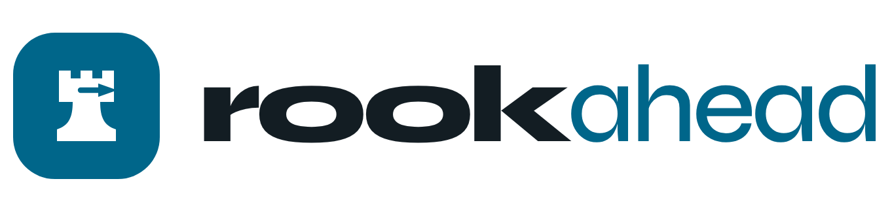
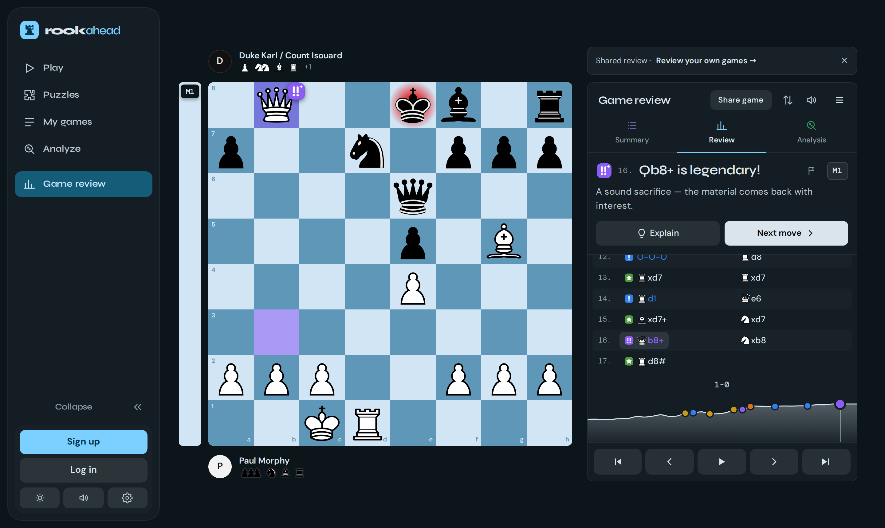
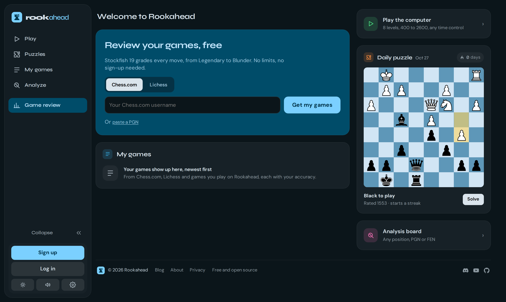

<p align="center">
  <a href="https://rookahead.com">
    <picture>
      <source media="(prefers-color-scheme: dark)" srcset="docs/images/logo-dark.png">
      
    </picture>
  </a>
</p>

<p align="center">
  <b>Free, unlimited chess game review in your browser.</b><br>
  Stockfish 19 grades every move, from Legendary to Blunder. No sign-up, no limit, no paywall.
</p>

<p align="center">
  <a href="https://rookahead.com"><b>rookahead.com</b></a> ·
  <a href="https://rookahead.com/blog">Blog</a> ·
  <a href="https://rookahead.com/blog/whats-new">What's new</a> ·
  <a href="https://discord.gg/ebm3NZNHZH">Discord</a> ·
  <a href="https://www.youtube.com/@rookahead">YouTube</a> ·
  <a href="https://rookahead.com/donate">Donate</a>
</p>

<p align="center">
  
</p>

## What it does

- **Game review.** Bring in your games by Chess.com or Lichess username, or paste a PGN. Every move gets one of eleven verdicts, from Legendary and Clutch down to Mistake, Oversight and Blunder, plus each side's accuracy and the key moments on an eval graph.
- **Explain.** Ask why a move was good or bad: the threat, what the move does, how it loses, and the better line, played out on the board.
- **On your own device.** Stockfish 19 runs in your browser, multi-threaded, with the full NNUE network. Your games are never uploaded, which is why it can be free and unlimited.
- **Puzzles.** Rated puzzles, Puzzle Sprint, a daily puzzle, and puzzles made from the mistakes in your own games.
- **Play the computer** at eight levels, from 400 to 2600, with any time control.
- **Analysis board** for any position, PGN or FEN, with up to five engine lines.
- **Share** a game or a single move as a link, an image, a GIF or an embedded board.
- **Accounts are optional.** Sign up only if you want your games and progress on every device.

<p align="center">
  
</p>

## How moves are graded

The rules behind every verdict are written down in [`docs/rulebook.md`](docs/rulebook.md), and [`src/lib/classify.ts`](src/lib/classify.ts) follows them. The blog explains them with examples: [How Rookahead grades a move](https://rookahead.com/blog/how-rookahead-grades-a-move) and [What counts as a sacrifice](https://rookahead.com/blog/what-counts-as-a-sacrifice).

## Support Rookahead

Rookahead is free for everyone, and every feature stays free. If it helps your chess, you can help keep it going:

- [rookahead.com/donate](https://rookahead.com/donate) (UPI in India)
- [GitHub Sponsors](https://github.com/sponsors/bijoyv9)
- [Buy Me a Coffee](https://buymeacoffee.com/bijoyv9i)

Starring the repo, sharing Rookahead with a friend and [reporting bugs](https://github.com/rookahead/rookahead/issues) help too. Come and talk chess on [Discord](https://discord.gg/ebm3NZNHZH).

## Development

### Running it

```bash
npm install     # also copies the Stockfish builds into public/engine/
npm run dev     # http://localhost:5173
```

Requires Node 20+. It starts on the **Lite** engine, a 2 MB network that loads instantly (still far stronger than any human).
Pick **Full** in Settings for the strongest analysis: that downloads the ~100 MB network once, and the browser caches it after that.

#### Multi-threading

Multi-threaded WASM needs `SharedArrayBuffer`, which browsers only allow on *cross-origin isolated* pages.
The dev and preview servers send the required headers (see `vite.config.ts`):

```
Cross-Origin-Opener-Policy: same-origin
Cross-Origin-Embedder-Policy: require-corp
```

If you host the built `dist/` elsewhere, send those two headers too, or the app falls back to a single thread.

### How moves are classified

Rookahead's own rules for every verdict live in [`docs/rulebook.md`](docs/rulebook.md); `src/lib/classify.ts` follows them.
The opening book is Lichess's CC0 opening list (`src/data/openings.json`).

- **Accuracy** — Lichess's open formula (volatility-weighted and harmonic means of per-move accuracy)

To rebuild the opening book: `node scripts/build-openings.mjs <dir with a.tsv … e.tsv>` from
https://github.com/lichess-org/chess-openings.

### Keyboard

| Key | Action |
| --- | --- |
| ← / → | Previous / next move |
| ↑ / Home | Start of the game |
| ↓ / End | End of the current line |
| F | Flip the board |
| L | Toggle the engine |
| Space | Play through the moves |

### Scripts

| Command | |
| --- | --- |
| `npm run dev` | Dev server |
| `npm run build` | Type-check and build to `dist/` |
| `npm run preview` | Serve the build (with isolation headers) |
| `npm test` | Unit tests (Vitest) |
| `npm run lint` | Lint (oxlint) |

Set `localStorage.setItem('rookahead.debug', '1')` in the browser console to log all UCI traffic.

### Layout

```
src/
  engine/Engine.ts        Stockfish worker wrapper: UCI, one-search-at-a-time queue, cancellation
  hooks/useAnalysis.ts    Live analysis (with per-position cache) and full-game review
  hooks/useEngine.ts      Engine lifecycle
  lib/tree.ts             Game tree (main line + variations), PGN import/export
  lib/uci.ts              UCI "info" line parser
  lib/evaluation.ts       Score conversion, win %, formatting
  lib/chesscom.ts         Chess.com public API client
  components/             Board (Chessground), eval bar & graph, move list, engine lines, dialogs
```

## Licences

Rookahead is free software under the **GNU General Public License v3.0 or later** (see `LICENSE`).

It builds on Stockfish.js (GPL-3.0) and Chessground (GPL-3.0-or-later), so anyone serving the app must also offer its source under the GPL.
The opening book comes from Lichess's chess-openings (CC0), and the Syne, DM Sans and DM Mono fonts are under the SIL Open Font License.
